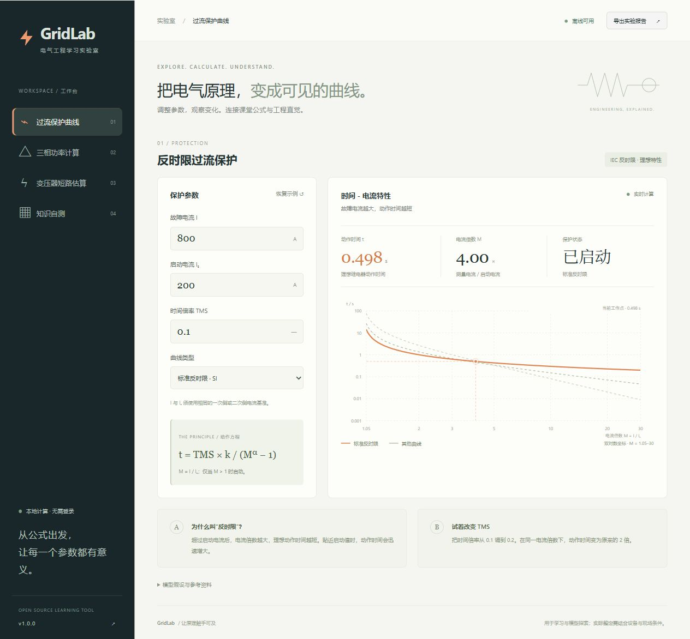

# GridLab · 电气计算与保护实验室

一个面向电气专业学习的中文交互项目：调整参数，查看计算结果和图形，再用原创练习检查理解。使用原生 HTML、CSS、JavaScript ES modules，无第三方运行依赖，无需账号或后端服务。

**[在线使用 GridLab](https://weizhegu999-ui.github.io/gridlab-cn/)** · 浏览器直接打开，无需安装。



## 可以做什么

- **反时限过流保护**：对比 IEC SI、VI、EI 理想曲线，查看电流倍数、启动状态和动作时间。
- **三相功率**：用线电压、线电流和功率因数计算 S、P、Q，并观察感性与容性功率三角形。
- **变压器短路估算**：估算低压端三相短路电流，比较无限大与有限大电源，并将结果传入保护模块。
- **知识自测**：12 道原创单选题、即时解析，答题进度保存在当前浏览器。
- **实验报告**：在浏览器中导出当前计算参数与结果。

所有计算在浏览器本地完成。项目资源由本地服务或 GitHub Pages 提供；无需 CDN。本地使用时不需要互联网连接。

## 本地启动

需要 **Node.js 20 或更高版本**。在项目目录运行：

```sh
node scripts/serve.mjs
```

打开终端显示的地址，默认是 `http://127.0.0.1:4173`。希望自动打开浏览器时运行：

```sh
node scripts/serve.mjs --open
```

Windows 可以双击 `启动.cmd`。它先使用 PATH 中的 `node.exe`，再尝试 Codex 已有的本地 Node 运行时；都不存在时会给出提示。

服务仅监听本机 `127.0.0.1`。默认端口被占用时，会依次尝试之后的 10 个端口。可用 `PORT` 环境变量指定起始端口，例如 PowerShell：

```powershell
$env:PORT = '4300'
node scripts/serve.mjs
```

按 `Ctrl+C` 停止。浏览器 ES modules 需要 HTTP 服务，请通过服务地址访问项目。

## 测试与检查

无需安装 npm 包：

```sh
node --test
node --check src/app.js
node --check src/engineering.js
node --check src/questions.js
node --check scripts/serve.mjs
```

GitHub CI 在 Node.js 22 和 24 上执行测试与语法检查。数值测试覆盖公式、边界输入和模型关系；这些检查不代表浏览器兼容性、真实继电器或现场设备测试。

当前版本的本地验证：22 项自动测试通过，并在桌面与窄屏浏览器检查了关键交互。验证范围见 [验证记录](docs/verification.md)；远程 CI 状态以 [GitHub Actions 最新结果](https://github.com/weizhegu999-ui/gridlab-cn/actions) 为准。

## 默认实验

| 模块 | 输入 | 结果约值 |
| --- | --- | --- |
| 三相感性功率 | 400 V、100 A、cosφ = 0.85 | S = 69.282 kVA，P = 58.890 kW，Q = +36.497 kvar |
| 变压器短路 | 1000 kVA、400 V、uk = 6%、无限大电源 | In = 1443.376 A，Ik = 24.056 kA |
| 标准反时限 SI | I = 800 A、Iset = 200 A、TMS = 0.1 | M = 4，t = 0.498 s |

计算公式、单位、参考来源及有限大电源示例见 [公式与模型说明](docs/theory.md)。

## 模型限制

三相功率模型假设负载平衡、波形正弦、稳态运行，采用被动负载约定：感性无功为正，容性无功为负。它不处理谐波、不平衡或有功反送。

短路模型只估算变压器低压端三相金属性短路的对称交流有效值，假设上级电源与变压器阻抗角相同。它不是 IEC 60909 的完整实现，也不是电磁暂态仿真；未考虑线路、电动机馈入、直流偏移、短路峰值等因素。

继电器采用 IEC 理想静态曲线，M ≤ 1 时不启动。曲线时间不含装置最短动作时间、启动容差、复归过程及断路器分闸时间。电流和启动整定值必须采用同一侧电流基准；默认比较使用相同启动值和 TMS。实际工程还需按设备资料与相关标准完成网络建模和保护配合校核。

## 目录

```text
gridlab-cn/
├─ index.html               页面与模块入口
├─ styles.css               页面样式
├─ src/
│  ├─ app.js                交互、绘图、进度与报告
│  ├─ engineering.js        独立计算核心
│  └─ questions.js          原创题库
├─ assets/favicon.svg       项目标识
├─ docs/theory.md           公式、示例与适用范围
├─ tests/                   数值与 HTTP 服务边界测试
├─ scripts/serve.mjs         原生本地静态服务
├─ .github/workflows/       CI 与手动 Pages 部署
├─ 启动.cmd                 Windows 启动入口
├─ package.json
└─ LICENSE
```

## 获取源码

[GitHub 仓库](https://github.com/weizhegu999-ui/gridlab-cn) 已公开，可直接访问、下载或克隆。

```sh
git clone https://github.com/weizhegu999-ui/gridlab-cn.git
cd gridlab-cn
node scripts/serve.mjs
```

## 部署到 GitHub Pages

1. 打开仓库 **Settings → Pages → Build and deployment**，将 Source 设为 **GitHub Actions**。
2. 打开 **Actions → Deploy GitHub Pages → Run workflow**，选择要发布的分支并运行。
3. 部署完成后，使用 workflow 的 `github-pages` 环境链接访问网站。项目使用相对资源路径，可部署在仓库子路径下。

Pages 工作流只在手动运行时部署。日后更新代码并推送到 GitHub 后，需再次打开 **Actions → Deploy GitHub Pages → Run workflow** 发布更新。它将 `index.html`、`styles.css`、`src/`、`assets/`、`docs/` 复制到临时 `_site/` 再上传，不发布测试、脚本或 Git 元数据。

## 许可

[MIT License](LICENSE) · Copyright © 2026 GridLab contributors。
